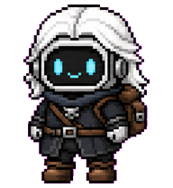
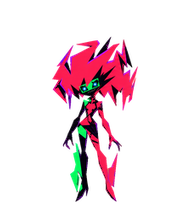

# Toni's Pets

An animated pet catalog containing Geralt and Capri.

## Add to Suzu

In the pet library menu, choose **Add library**, enter **Toni's Pets**, and paste this catalog URL:

```text
https://raw.githubusercontent.com/thisistoni/suzu-pets/main/catalog.json
```

| Pet | Preview | Format | Sprite sheet |
| --- | --- | --- | --- |
| Geralt |  | v1 · 1536 × 1872 · 9 animation rows | [PNG](pets/geralt/spritesheet.png) |
| Capri |  | v2 · 1536 × 2288 · 9 animation rows and 16 look directions | [PNG](pets/capri/spritesheet.png) |

Each pet also includes a data-only `pet.json` manifest. Catalog sprite paths are relative to the catalog URL. Explicit `spriteVersionNumber` values support Suzu's v1/v2 filters, and `submittedBy` preserves creator credit.

The sprite sheets retain their original encoded bytes. Previews are extracted from the first idle frame.

## Artwork

Artwork supplied by **thisistoni**. All rights reserved; ask the creator before redistribution or reuse. Any underlying third-party character rights remain with their respective owners.

Capri is also available on [Petdex](https://petdex.dev/pets/capri).
